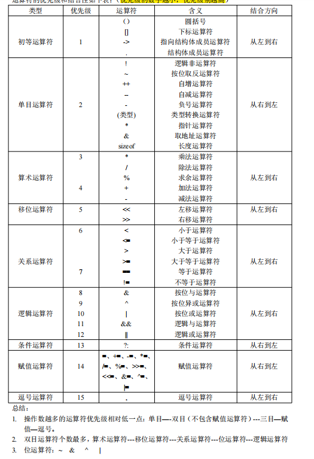
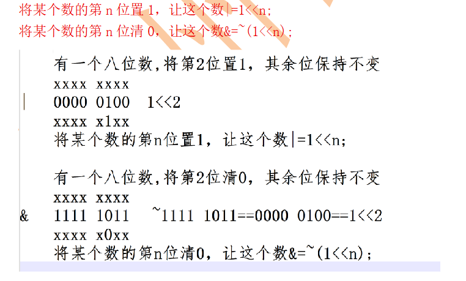
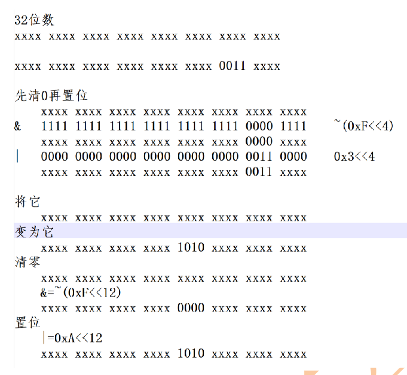
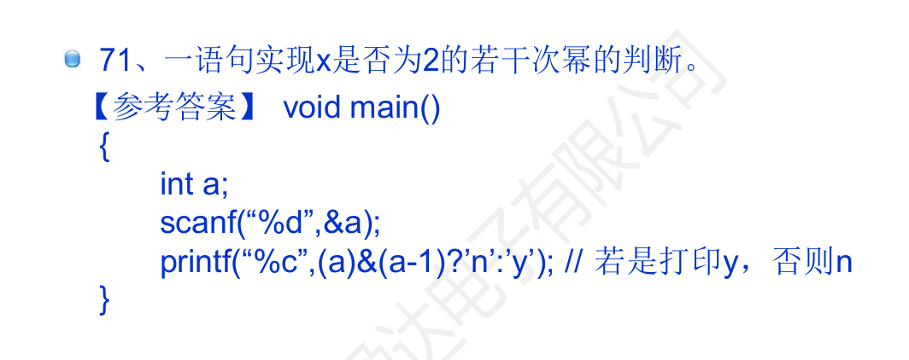
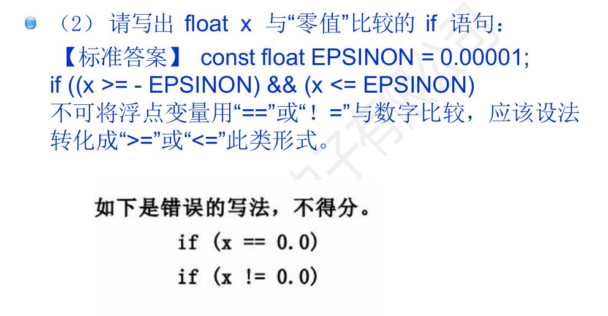
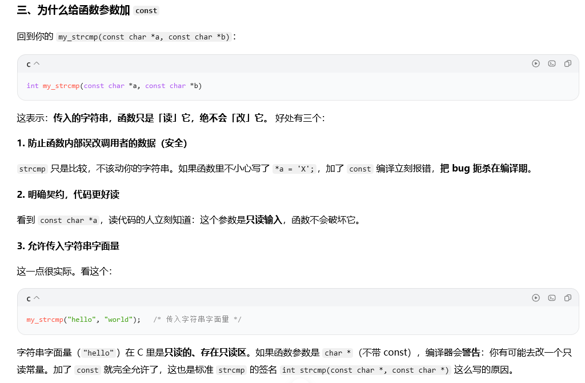
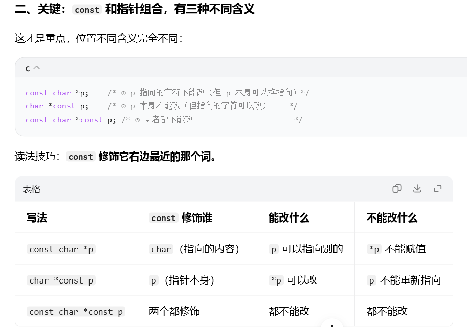
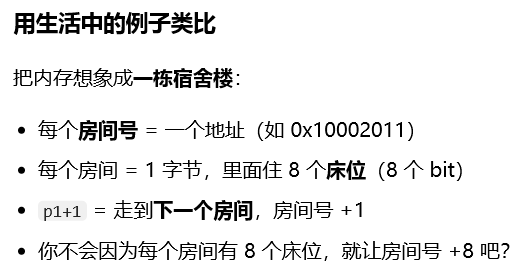
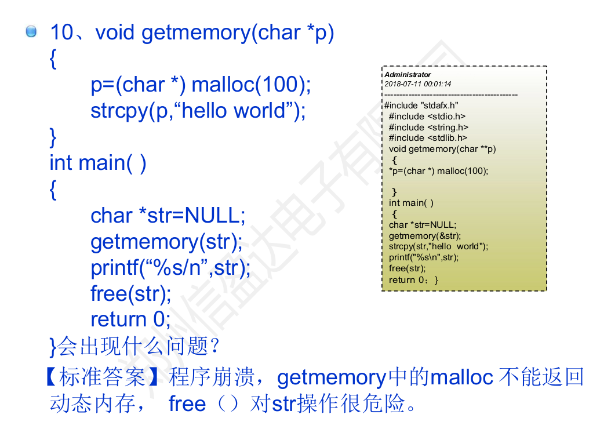

# C 语言知识总结与易错点复盘手册

## 一、程序结构与编译执行流程

C 程序由一个或多个源文件组成，每个源文件独立编译，最后由链接器合并为一个可执行文件。理解这条链路，是定位"编译报错"与"链接报错"的前提。

### （一）从源文件到可执行文件的四个阶段

| 阶段 | 工具 | 输入 | 输出 | 该阶段常见错误 |
|------|------|------|------|----------------|
| 预处理 | cpp | `a.c` | 展开后的 `.i` 文件 | 头文件路径错误、宏起点/终点不匹配 |
| 编译 | cc1 | `.i` | 汇编 `.s` | 语法错误、类型不匹配、隐式声明告警 |
| 汇编 | as | `.s` | 目标文件 `.o` | 极少出错，通常为内联汇编问题 |
| 链接 | ld | 多个 `.o` + 库 | 可执行文件 | `undefined reference`、重复定义 |

> 关键判别：报错信息含"行号 + 语法"多为编译期问题（改代码）；报错含 `undefined reference to` 或 `multiple definition` 属链接期问题（查声明、定义、库）。

### （二）main 函数的规范写法

```c
int main(void)                 /* 无参数 */
{
    printf("Hello\n");
    return 0;                  /* 0 表示正常退出 */
}

int main(int argc, char *argv[])   /* 带命令行参数 */
{
    return 0;
}
```

要记住三点：返回类型必须是 `int`；`return 0;` 表示成功，非 0 表示异常终止；`void main()` 不是标准写法，不同编译器行为不一致。

### （三）声明与定义的区别

- **定义**：分配存储空间，全程序只能有一处（如 `int a = 1;`、函数体）。
- **声明**：只告知编译器"存在这个名字及类型"，可有多处（如 `extern int a;`、函数原型）。
- **头文件**：放声明（函数原型、类型定义、宏），不放变量定义，避免多文件重复定义。

---

## 二、数据类型与变量

### （一）基本类型与长度

| 类型 | 典型长度 | 说明 |
|------|----------|------|
| `char` | 1 字节 | 字符型，C 中即最小整型 |
| `short` | 2 字节 | 短整型 |
| `int` | 4 字节 | 最常用整型 |
| `long` | 4 或 8 字节 | 长度依赖平台：Windows 64 位为 4，Linux 64 位为 8 |
| `long long` | 8 字节 | 跨平台稳定的 64 位整型 |
| `float` | 4 字节 | 单精度，约 6~7 位有效数字 |
| `double` | 8 字节 | 双精度，约 15~16 位有效数字 |
| 指针 | 4 或 8 字节 | 与平台地址宽度一致 |

长度不是"背下来的"，而是用 `sizeof` 查出来的。`sizeof` 的返回类型是 `size_t`，`printf` 时应使用 `%zu`，写成 `%d` 在 64 位平台属未定义行为。

再补两点：`sizeof` 不是函数，是**运算符**，也是 32 个关键字之一，表达式在编译期就求值；所以 `sizeof(float)` 直接得到 4，不需要任何头文件，也不能当作函数指针传递。

### （二）取值范围与整型溢出

以 32 位 `int` 为例：`signed int` 范围是 -2147483648 ~ 2147483647，`unsigned int` 是 0 ~ 4294967295。

- **有符号整型溢出是未定义行为（UB）**，不是"变成负数"这么简单，编译器可据此做任意优化。
- **无符号整型按 2 的模回绕**（`0u - 1` 得到 `4294967295`），行为有定义，但通常不是想要的结果。

```c
int a = 2147483647;
a = a + 1;                  /* UB：有符号溢出 */
unsigned b = 0;
b = b - 1;                  /* 合法回绕，b 变为 4294967295 */
```

### （三）常量与字面量

| 写法 | 含义 | 备注 |
|------|------|------|
| `10`、`0x1F`、`017` | 十进制 / 十六进制 / 八进制 | 以 0 开头是八进制，`010` 等于 8 |
| `10U`、`10L`、`10LL` | 无符号 / long / long long | 后缀大小写均可 |
| `1.5`、`1.5f` | double / float | 不加 `f` 是 double |
| `'A'`、`'\n'`、`'\\'` | 字符常量 | 单引号，本质是 int |
| `"A"` | 字符串常量 | 双引号，含结尾 `'\0'`，长度为 2 |

字符常量除了直接写字面字符，还能用转义写法表示任意编码：`'\101'` 是**八进制**转义（`\` 后最多 3 位八进制数字，101 即十进制 65，也就是 `'A'`）；`'\x41'` 是**十六进制**转义（`\x` 后跟十六进制数字）。区别只在有没有那个 `x` —— 同一个字符 `'A'`，两种写法都成立。

### （四）类型转换

- **隐式转换**：赋值、算术运算、函数传参时自动进行，小类型向大类型提升（整数提升、寻常算术转换）。
- **显式转换**：`(double)a / b`，明确意图，也便于阅读。

两个高频陷阱：

1. **整数除法截断**：`5 / 2` 得 `2`，想得到 `2.5` 必须写 `5.0 / 2` 或 `(double)5 / 2`。
2. **有符号与无符号混比**：`int i` 与 `unsigned n` 比较时，`i` 会被转换为无符号数；`for (int i = n - 1; i >= 0; i--)` 若 `n` 为无符号，条件恒真，直接死循环或越界。

再补两条同样高频的：

3. **浮点转整型是截断，不是四舍五入**：`(int)3.99` 得 `3`，`(int)-3.99` 得 `-3`（向零取整）。要四舍五入得显式调用 `round()`。
4. **算式中只要出现无符号数，其余操作数都转为无符号**：`int` 与 `unsigned` 混合运算时，`int` 也被转成 `unsigned`，`-1` 变成 `4294967295`，除法、比较、取模的结果都会反直觉。这是"有符号/无符号混比"那条的完整版，写 `if (i < n)` 之前先确认两边类型一致。

### （五）程序的内存分区

一个运行中的程序，内存按用途被切成几个区段。搞清"变量住在哪"，才能解释为什么有些赋值会崩、有些变量有初值、有些是垃圾值。

| 区段 | 存放内容 | 读写属性 | 生命周期 |
|------|----------|----------|----------|
| 代码段 `.text` | 机器指令、`switch` 跳转表 | 只读、可执行 | 整个运行期 |
| 常量区 `.rodata` | 字符串字面量、`const` 全局量、`static const` | **只读** | 整个运行期 |
| 全局/静态区 `.data` | 已初始化的全局变量、`static` | 可读写 | 整个运行期 |
| 全局/静态区 `.bss` | 未初始化（或初始化为 0）的全局、`static` | 可读写 | 启动时清零 |
| 栈 | 局部变量、函数参数、返回地址 | 可读写 | 函数调用期间，自动回收 |
| 堆 | `malloc` / `calloc` / `realloc` 分配 | 可读写 | 手动 `free` |

常量区最需要记住的一点是：**它被操作系统映射为只读页**。往这里写不是"值没改成功"，而是进程被当场终止。

```c
char *s1 = "hello";        /* 指针指向常量区，内容不可改 */
s1[0] = 'H';               /* 运行期崩溃：写入只读页 */

char s2[] = "hello";       /* 在栈上有自己的可写副本 */
s2[0] = 'H';               /* 正确，s2 是数组不是指针 */

const char *s3 = "hello";  /* const 是编译期约束，真正只读来自段属性 */
```

- **`const` 不等于落在常量区**：`const` 局部变量通常仍在栈上，只是编译器禁止你写；真正只读的是字符串字面量和 `const` 全局量，写它们必崩。
- **想改内容就别指向字面量**：`char buf[] = "hello";` 或 `char buf[32]; strcpy(buf, "hello");` 都行，`char *p = "hello";` 不行。
- **崩溃特征**：报段错误（Linux）或"写入位置 0x… 时发生访问冲突"（Windows），地址通常很低，因为它落在可执行文件映射的只读段里。
- **判断口诀**：要修改 → 用数组或堆；只共享只读文本 → 用 `const char *`。

---

## 三、运算符与表达式

### （一）优先级与结合性（常用部分）

由高到低：后缀（`()` `[]` `->` `.` `++` `--`）→ 一元（`!` `~` `++` `--` `*` `&` `sizeof` 强制转换）→ 乘除取余 → 加减 → 移位 → 关系 → 相等 → 位与 → 位异或 → 位或 → 逻辑与 → 逻辑或 → 条件 `?:` → 赋值 → 逗号。



不必强记全部，但要记住三条规律（比背表省力）：

- 操作数越多，优先级越低：单目 → 双目（不含赋值）→ 三目 → 赋值。
- 双目运算符里个数最多的是算术，其次移位 → 关系 → 位 → 逻辑，看"运算粒度"就能排序。
- 位运算符的顺序固定为 `~` → `&` → `^` → `|`，与逻辑运算符的 `!` → `&&` → `||` 一一对应，别搞反。

两条纪律更实用：**不确定就加括号**；**位运算与关系运算混用时必须加括号**。

```c
if (a & 1 == 0)      /* 错：实际是 a & (1 == 0)，恒为 a & 0 */
if ((a & 1) == 0)    /* 对：判断奇偶 */
```

### （二）自增自减

- `i++` 先取值后自增，`++i` 先自增后取值；单独成句时二者等价，作为表达式使用时才有差别。
- **同一表达式中对同一变量多次修改属未定义行为**：`i = i++ + ++i;`、`printf("%d %d", i++, i++);` 的结果取决于编译器，不可依赖。

### （三）短路求值

`&&` 与 `||` 有短路特性：左侧已能确定结果时，右侧不求值。这既是性能特性，也是安全写法的基础：

```c
if (p != NULL && *p == 0) { /* 先判空再解引用，安全 */ }
```

反过来，若右侧含有副作用（如 `i++`、`func()`），短路会导致它**可能根本不执行**，这是逻辑错误的常见来源。

### （四）位运算要点

`&` `|` `^` `~` `<<` `>>` 只对整型有效。左移超出位宽或对负数左移属 UB；`>>` 对负数是否补符号位由实现定义。实际用途集中在四件事：置位、清位、读位、掩码批量操作。

四个动作都是"先造一个只有目标位不同的数，再与原值运算"，其余位保持不变：

```c
x |=  (1 << n);        /* 第 n 位置 1，其余位不变 */
x &= ~(1 << n);        /* 第 n 位清 0，其余位不变 */
x ^=  (1 << n);        /* 第 n 位取反 */
(x >> n) & 1;          /* 读出第 n 位的值 */
```



一位一位来太慢时，用掩码一次处理连续几位。核心是"先清 0 再置位"，否则新旧数据会或在一起：

```c
x &= ~(0xF << 4);      /* 先清掉 bit4~bit7 */
x |=  (0x3 << 4);      /* 再写入 0011 */
```



位运算还有一种"一句话"用法，考试里常见：判断整数是不是 2 的若干次幂。2 的幂的二进制只有一个 1，减 1 之后低位全变 1、那个 1 变 0，两者与运算必然为 0。

```c
if (a > 0 && (a & (a - 1)) == 0) { /* a 是 2 的幂 */ }
```



---

## 四、控制流

### （一）分支结构

- `if / else if / else`：注意"悬空 else"——`else` 与最近的未配对 `if` 结合，缩进骗不了编译器。
- `switch`：`case` 后必须是整型常量表达式；**漏写 `break` 会贯穿执行**到下一个 `case`，这是最经典的错误之一；`default` 建议保留。
- 但**贯穿不总是 bug**：有意省略 `break`，让多个 `case` 共享同一段处理，是合法且常用的写法。典型例子是"某日是本年第几天"—— 从 12 月往下贯穿累加，遇到目标月份就停，比一串 `if-else` 干净得多。

```c
switch (grade) {
case 'A': printf("优秀"); break;   /* 必须 break */
case 'B': printf("良好"); break;
default:  printf("未知");  break;
}
```

### （二）循环结构

| 结构 | 特点 | 适用场景 |
|------|------|----------|
| `for` | 初始化、条件、步进集中在一处 | 次数已知的循环 |
| `while` | 先判断后执行 | 次数未知、依赖条件的循环 |
| `do...while` | 先执行后判断，至少执行一次 | 至少要做一次的操作 |

`for` 的三个表达式均可省略（`for (;;)` 为死循环），但**循环体内的变量更新别漏**，否则死循环。

### （三）跳转语句

- `break`：跳出最近一层循环或 `switch`。
- `continue`：跳过本次，进入下一次判断。
- `goto`：只建议用于"多层循环统一跳出"或"函数内统一错误清理"；滥用会破坏结构化。

### （四）浮点比较

浮点数不能用 `==` 判断相等，应比较差的绝对值：

```c
#include <math.h>
if (fabs(a - b) < 1e-9) { /* 视为相等 */ }
```

原因：`0.1 + 0.2 != 0.3`，二进制无法精确表示多数十进制小数。

与"零值"比较是笔试题的高频点。判等要写成"落在误差区间内"，而不是问"是不是正好等于 0"：

```c
#define EPSILON 0.00001
if ((x >= -EPSILON) && (x <= EPSILON)) { /* 视为 0 */ }
```



注意 `if (x == 0.0)` 和 `if (x != 0.0)` 这两种写法在要求严格的场合作答里是**不给分**的，因为浮点误差会让本该"等于 0"的值变成 `1e-17`。

### （五）排序算法速记

背代码不是目标，记住"骨架 + 差异点"才不容易忘。六种排序的记忆锚点如下，写不出来时按锚点反推：

| 算法 | 记忆锚点 | 差异点 |
|------|----------|--------|
| 冒泡 | 双重 `for` + 相邻交换 | 条件 `a[j] > a[j+1]` 一趟把极值顶到末尾 |
| 选择 | 双重 `for` + 找最小下标 + 最后才交换 | 交换次数最少，只换 n-1 次 |
| 插入 | 从 `i = 1` 开始 + `while` 后移腾位 + `a[j+1] = key` | 近乎有序时最快，稳定性好 |
| 快排 | 双指针（哨兵）+ `while` 交替填坑 + 递归 | 分治，平均 O(n log n)，最坏 O(n²) |
| 归并 | 递归拆 + 双指针合并到临时数组 | 需要 O(n) 额外空间，稳定 |
| 堆排 | 建堆 + 反复取堆顶 + 向下调整 | 原地排序，不稳定 |

共同骨架只有三句：**外层控制趟数、内层做比较与移动、每趟结束缩小有序区**。把这三句记住，剩下的只是"比较什么、往哪移动"的区别。

---

## 五、函数

一个程序的结构可以概括成一句话：**主函数 + 若干子函数**。`main` 负责调度，子函数负责具体的计算与处理；合理拆分的前提，是函数之间只通过"参数进、返回值出"打交道，而不是共享一堆全局变量。

### （一）定义、声明与调用

- 函数由返回类型、函数名、参数列表、函数体组成；调用前必须可见声明（原型）。
- C99 起取消隐式声明，未声明就调用会产生告警或错误，且参数类型会被错误推断。
- 参数传递是**值传递**：函数内修改形参不影响实参。要修改实参，必须传地址（指针）。

```c
void swap_wrong(int a, int b) { int t = a; a = b; b = t; }   /* 无效 */
void swap_ok(int *a, int *b)  { int t = *a; *a = *b; *b = t; } /* 调用 swap_ok(&x, &y) */
```

关于数组与指针作参数，有三条容易混的结论，值得单独记：

- **数组名是常量指针**（地址固定，不能 `arr++`）；但传进函数退化成指针后，形参只是这个地址的"拷贝"，是个普通变量，可以随便移动 —— 移动它不影响调用者的数组。
- **凡是函数里要遍历数组，长度必须单独传**：数组名传进去后，长度信息就丢了，函数内的 `sizeof(arr)` 得到的是指针大小（8 或 4），不是数组长度。
- **指针参数能"带出"结果，但带不出 `malloc` 的返回值**：`void getmemory(char *p)` 里 `p = malloc(100)` 只改了形参这个拷贝，调用者的指针仍是 `NULL`（详见第九章的 getmemory 例题）。

### （二）返回值：结果要 return 出来，不要只靠副作用

初学者常有两种毛病：一是函数清一色以 `void` 收尾，算完只在函数内 `printf`，调用方拿不到结果，想复用只能再抄一遍；二是结果靠"出参"或全局变量带出去，顺手把入参也改了，调用处的原数据就脏了。更稳的写法是三条纪律。

1. **能返回就返回**：计算结果用 `return` 交出去；函数里不打印，打印与否由调用者决定。
2. **输入只读**：入参加 `const`，声明"我不动你"；要产出新值，就另开返回值或新缓冲区，而不是就地改实参。
3. **每条路径都有返回**：非 `void` 函数漏写 `return` 属 UB，编译器会告警 `control reaches end of non-void function`，务必清零这类告警。

```c
/* 不推荐：结果靠出参带出，还改了入参 */
void normalize_bad(int *v, int n)
{
    for (int i = 0; i < n; i++)
        v[i] = v[i] / 100;           /* 原数组被就地改写，无法回退 */
}

/* 推荐：输入只读，结果写进调用者给的缓冲区，返回值表示处理了几个 */
int normalize(const int *src, int n, int *dst, int cap)
{
    if (src == NULL || dst == NULL || n > cap)
        return -1;                   /* 用返回值表达失败，而不是静默继续 */
    for (int i = 0; i < n; i++)
        dst[i] = src[i] / 100;
    return n;
}
```

- **要返回多个值时**，优先用结构体按值返回（小结构体编译器会走寄存器，成本很低），而不是全局变量；只有大块数据才用出参。出参名字加 `_out` 后缀，一眼看出会被写。

关于"输入只读"这条纪律，值得展开说一下 `const` 加在参数上的实际作用（这也是面试爱问的点）：



三条好处里最后一条最容易被忽略：`char *` 形参无法接收字符串字面量（那是指向只读区的指针），只有 `const char *` 才收得下 —— 这正是标准库 `strcmp` 的签名写成 `int strcmp(const char *, const char *)` 的原因。

- **返回指针要管生命周期**：永远不要返回局部变量的地址。函数返回后栈帧已销毁，那个地址就是个野指针，用之前必须先想清楚它指向的空间还在不在。

```c
char *bad(void)      { char buf[32]; return buf; }   /* 悬垂，调用即 UB */
static char sbuf[32];
char *ok(void)       { /* 填 sbuf */ return sbuf; }   /* 可，但不可重入 */
```

- **`main` 的返回值就是退出码**：`return 0` 表示成功，非 0 表示异常，脚本和 CI 靠它判断成败。

### （三）回调函数：用函数指针做参数

回调就是"把一段行为当参数传进去"。被调函数只管流程（何时遍历、何时比较），具体做什么由调用者决定。C 没有闭包，实现方式就是**函数指针做参数**。

```c
#include <stdio.h>

/* 参数里接收一个函数指针：它吃一个 int、吐一个 int */
void for_each(int *arr, int n, int (*fn)(int))
{
    for (int i = 0; i < n; i++)
        arr[i] = fn(arr[i]);       /* 这里不关心 fn 到底做什么 */
}

int square(int x) { return x * x; }
int negate(int x) { return -x; }

int main(void)
{
    int a[3] = {1, 2, 3};
    for_each(a, 3, square);        /* 传函数名，不能写成 square() */
    for_each(a, 3, negate);        /* 换行为只换参数，流程一行不改 */
    return 0;
}
```

写法的三件套：声明用 `返回类型 (*名字)(参数表)`；传参只写函数名，**加括号就变成先调用**；调用 `p(...)` 与 `(*p)(...)` 等价。

- **用 `typedef` 起名**，避免括号看错位置：

```c
typedef int (*cmp_fn)(const void *, const void *);
void sort(int *a, int n, cmp_fn cmp);
```

- **标准库现成例子**：`qsort` 的第四个参数就是回调。

```c
#include <stdlib.h>

int cmp_int(const void *a, const void *b)
{
    int x = *(const int *)a, y = *(const int *)b;
    return (x > y) - (x < y);      /* 不要直接 return x - y，差值会溢出 */
}

qsort(arr, n, sizeof(arr[0]), cmp_int);
```

- **四个常见错误**：
  1. 传成 `cmp_int()` —— 传的是返回值，类型不匹配，要么编译报错要么运行崩。
  2. 签名必须完全一致：参数表、返回类型都对得上，`qsort` 要的是 `const void *` 两个参数。
  3. 回调里不能用调用者栈上的局部变量地址（返回时已销毁）；需要携带上下文就多传一个 `void *ctx` 参数。
  4. 函数指针为 `NULL` 就直接调用，必然崩 —— 调用前判空。

> 一句话记忆：看到参数里出现 `int (*)(...)` 这种写法，就知道这个函数在等"一段行为"，它自己只提供骨架。

### （四）递归

递归必须满足两点：有明确的终止条件；每次递归规模向终止条件收敛。缺失终止条件会导致栈溢出（stack overflow）。

### （五）作用域与存储类

| 关键字 | 作用 | 生命周期 |
|--------|------|----------|
| `auto` | 局部变量默认，可省略 | 函数执行期间 |
| `static`（局部） | 值在函数调用间保留，只初始化一次 | 整个程序运行期 |
| `static`（全局/函数） | 限制为内部链接，仅本文件可见 | 整个程序运行期 |
| `extern` | 声明外部定义的变量或函数 | 取决于定义处 |
| `register` | 建议放入寄存器（现代编译器多忽略） | 函数执行期间 |

`static` 修饰局部变量的实质是**延长生命周期**：变量从"函数执行期间"变成"整个程序运行期"，但它作用域不变（还是只能在这个函数里访问），且只在第一次进入时初始化一次。这也是它常被用来做"函数级计数器"和"一次性初始化标志"的原因。

### （六）函数章问题小结

这一章踩过的三个点，答案都指向同一件事 —— **函数拿到的是拷贝**：

- 凡是函数里要遍历数组，长度都得作为参数单独传，因为数组名传进去后长度信息就丢了。
- 永远不要返回局部变量的地址：返回的地址默认就是野指针，用之前先确认它指向的空间还在。
- 数组名本身是**常量指针**（地址固定），但传进函数退化成指针后，形参成了这个地址的"拷贝"，是个普通变量，可以随便移动 —— 移动形参不会动到调用者的数组。

---

## 六、数组与字符串

### （一）数组基础

- 下标从 0 开始，`int a[5]` 的合法下标是 0~4；`a[5]` 越界，属未定义行为，可能不报错但会破坏其他数据。
- 二维数组按行优先存储：`int m[3][4]` 等价于 3 个 `int[4]`。
- 数组长度必须是编译期常量（C99 起支持变长数组 VLA，但可移植性差，工程中慎用）。

### （二）数组名与指针

数组名在多数表达式中**退化为指向首元素的指针**，但有两个例外：

1. `sizeof(arr)` 得到整个数组的字节数，不是指针大小。
2. `&arr` 的类型是"数组指针"，`&arr + 1` 跳过整个数组。

作为函数参数时，数组一律退化为指针，因此函数内 `sizeof` 拿不到数组长度，必须额外传长度。

### （三）字符串与 '\0'

C 字符串是以 `'\0'` 结尾的字符数组，`'\0'` 不计入 `strlen`，但占用存储空间：

```c
char s1[] = "abc";      /* 长度 4 字节：'a','b','c','\0'，可修改 */
char *s2  = "abc";      /* 指向只读常量区，s2[0] = 'x' 属 UB，运行可能崩溃 */
sizeof("abc")           /* 4 */
strlen("abc")           /* 3 */
```

`s2` 指向的 `"abc"` 在常量区（`.rodata`），那一段被系统映射为只读页 —— 所以 `s2[0] = 'x'` 不是"改不掉"，而是进程当场被终止。要修改内容就换数组：`char s2[] = "abc";`，它在栈上有自己的可写副本。内存分区的完整划分见第二章（五）。

这里有个经典例题，错法和上一段正好互补 —— 不是"写只读区"，而是"写超了"：

```c
char szstr[10];
strcpy(szstr, "0123456789");   /* 11 字节（含结尾 '\0'）塞进 10 字节的盒子 */
```

结果是长度不一致，运行时出现**段错误**（或悄悄写坏相邻变量）。这类越界编译器不会报错，只会在运行时以"莫名其妙的崩溃"形式出现。

![图 7 例题：char szstr[10] 存 11 字节的字符串，长度不一致导致段错误](images/strcpy-overflow.png)

### （四）常用字符串函数

| 函数 | 作用 | 常见误用 |
|------|------|----------|
| `strlen` | 求长度（不含 `'\0'`） | 对未终止的数组调用会越界读 |
| `strcpy` / `strncpy` | 复制 | `strcpy` 不检查目标容量；`strncpy` 不保证补 `'\0'` |
| `strcat` / `strncat` | 拼接 | 目标缓冲区空间不足导致溢出 |
| `strcmp` | 比较 | 返回 0 表示相等，直接用 `if (strcmp(a, b))` 判断"相等"是反的 |
| `strchr` / `strstr` | 查找字符 / 子串 | 未判断返回 `NULL` 就解引用 |

更安全的写法是用 `snprintf` 代替 `strcpy` / `sprintf`，并显式传入缓冲区大小。

---

## 七、指针

### （一）指针的本质

指针是存放地址的变量，`&` 取地址，`*` 解引用。指针的类型决定了"一次解引用访问多少字节"以及"指针加减移动多少字节"。

```c
int a = 10;
int *p = &a;      /* p 存放 a 的地址 */
*p = 20;          /* 通过指针修改 a */
```

### （二）指针运算与数组关系

- `p + 1` 移动 `sizeof(*p)` 个字节，不是 1 个字节。
- 同一数组内的两个指针相减，得到相隔的元素个数（`ptrdiff_t`）。
- `a[i]` 等价于 `*(a + i)`，也等价于 `*(i + a)`。

### （三）多级指针与函数指针

```c
int **pp;                        /* 指向"int 指针"的指针 */
int (*fp)(int, int);             /* 函数指针：指向返回 int、两个 int 参数的函数 */
int (*pa)[4];                    /* 数组指针：指向 int[4] */
int *parr[4];                    /* 指针数组：4 个 int* 元素 */
```

`int (*fp)(int,int)` 与 `int *fp(int,int)` 完全不同：后者是"返回指针的函数"。读法：从变量名出发，先看右边，再看左边，括号优先。

函数指针最常见的正经用途就是**回调**：把它当参数传给别人，由对方在合适的时机调用。写法与标准库例子见第五章（三）。

### （四）const 与指针

| 写法 | 含义 |
|------|------|
| `const int *p` | 指向的内容不可改，指针本身可改 |
| `int * const p` | 指针本身不可改，指向的内容可改 |
| `const int * const p` | 两者都不可改 |

口诀：`const` 修饰它左边的东西；左边没有东西时，修饰右边的类型。另一种同样流行的记法是"`const` 修饰它**右边最近**的那个词"，两种说法指向同一个结论 —— 关键看 `const` 和 `*` 谁在前。



### （五）空指针与野指针

- **空指针**：`int *p = NULL;`，解引用会崩溃，使用前必须判空。
- **野指针**：未初始化的指针，指向随机地址；`free` 之后未置空的指针（悬垂指针）同样危险。
- 关键细节：**`free(p)` 只归还内存，不会把 `p` 置成 `NULL`**。释放后 `p` 仍指向那块已经不属于你的地址，这就是悬垂指针的成因，也是 `free` 之后要立刻 `p = NULL` 的理由。
- 纪律：指针定义即初始化；`free(p); p = NULL;` 成对出现。

---

## 八、结构体、共用体、枚举与 typedef

### （一）结构体定义与使用

```c
struct Student {
    int  id;
    char name[20];
    int  score;
};
struct Student s = { 1001, "张三", 92 };
struct Student *ps = &s;
printf("%d\n", ps->score);   /* 指针用 ->，变量用 . */
```

结构体变量之间可以直接赋值（整体拷贝），但不能直接用 `==` 比较，需逐成员比较或用 `memcmp`（注意填充字节）。

### （二）内存对齐：先找对齐值，再逐成员排，最后整体补齐

`sizeof(struct)` 常常大于成员大小之和，因为编译器要保证每个成员落在"对齐"的地址上。

理解对齐之前先记住一句话：**内存地址是按"字节"编号的，不是按"位"编号的**。每个地址对应 1 个字节（8 个 bit），`p + 1` 是走到下一个字节，不是走 8 个 bit。



算大小只需三步，顺序不能乱：

1. **先找对齐值**：结构体的对齐值 = 所有成员对齐值中的最大值。单个成员的对齐值通常等于自身大小（`char` 1、`short` 2、`int` 4、`double` 8，指针按平台字长）；数组按元素类型算，嵌套的结构体成员按它自己的对齐值算。
2. **再逐成员排**：每个成员的起始偏移必须是"自身对齐值"的整数倍，不够就在**该成员前面**填空洞（padding）。
3. **最后整体对齐**：总大小必须是"最大对齐值"的整数倍，不够在**尾部**补齐 —— 这样结构体数组里每个元素才都对齐。

同样三个成员，换个顺序就差 4 字节：

```c
struct A { char c; int i; short s; };   /* 12 字节 */
struct B { int i; short s; char c; };   /*  8 字节 */
```

`struct A`（char → int → short）的排布：

| 成员 | 大小 | 对齐 | 偏移 | 说明 |
|------|------|------|------|------|
| `c` | 1 | 1 | 0 | 占第 0 字节 |
| 填充 | 3 | — | 1~3 | 让 `i` 从 4 的倍数开始 |
| `i` | 4 | 4 | 4 | 占 4~7 |
| `s` | 2 | 2 | 8 | 占 8~9 |
| 填充 | 2 | — | 10~11 | 尾部补到 12（4 的倍数） |

`struct B`（int → short → char）的排布：

| 成员 | 大小 | 对齐 | 偏移 | 说明 |
|------|------|------|------|------|
| `i` | 4 | 4 | 0 | 占 0~3 |
| `s` | 2 | 2 | 4 | 占 4~5 |
| `c` | 1 | 1 | 6 | 占第 6 字节 |
| 填充 | 1 | — | 7 | 尾部补到 8（4 的倍数） |

这就是"**成员顺序改变结构体大小**"的由来：字段没变、逻辑没变，只调了声明顺序，`sizeof` 就可能差几字节。

- **优化手段**：成员按对齐值从大到小排，填充自然最少。工程上把 `int`、指针、`double` 放前面，`char`、`short` 放最后。
- **别手算写死长度**：用 `sizeof` 取长度、用 `offsetof`（`<stddef.h>`）验偏移；换平台或换编译器时，`long`、指针、`double` 的对齐要求都可能变。
- **一行代码守住布局**：`_Static_assert(sizeof(struct A) == 12, "layout changed");`，布局一旦被改动，编译期就报错，比运行期踩内存好排查得多。
- **紧凑布局有代价**：通信协议与二进制文件要求无填充时可用 `#pragma pack(1)`（或 `__attribute__((packed))`），但成员可能落在非对齐地址 —— ARM 上直接取址会 fault 或明显变慢，逐字节序列化才是可移植做法。
- **比较陷阱**：`memcmp` 比较结构体会连填充字节一起比，字段完全相同的两个变量也可能"不相等"；务必逐字段比较。

### （三）共用体：所有成员共用一块内存

`union` 的成员共享同一段内存，任一时刻只有一个成员"有效"。它的对齐规则与结构体同源，也是**先找对齐值，再定大小**：

1. **对齐值**：取成员中最大的对齐值，与结构体一致。
2. **大小**：不小于最大成员的大小，且必须是"对齐值"的整数倍（向上取整）。

三行代码最能说明问题：

```c
union U1 { char c[5]; int i; };        /* 最大 5，对齐 4 → 8 字节 */
union U2 { char c[8]; int i; };        /* 最大 8，对齐 4 → 8 字节 */
union U3 { char c[5]; };               /* 最大 5，对齐 1 → 5 字节 */
```

`union U1` 的布局（共 8 字节，`c` 与 `i` 从同一地址开始）：

| 成员 | 占几字节 | 落在哪些位置 |
|------|----------|--------------|
| `c[5]` | 5 | 第 0~4 字节 |
| `i` | 4 | 第 0~3 字节（与 `c[0]`~`c[3]` 重叠） |
| 尾填充 | 3 | 第 5~7 字节（补到 4 的倍数） |

注意最后一个坑：**union 大小不等于"最大成员大小"**。`char c[5]` 配 `int` 是 8 而不是 5，按 5 开缓冲区就会写越界。

- **经典用法：判断大小端**（同一段字节的两种解释）：

```c
#include <stdio.h>

int main(void)
{
    union { unsigned int i; unsigned char b[4]; } u;
    u.i = 1;
    if (u.b[0] == 1) printf("小端\n");    /* 低位字节放在低地址 */
    else             printf("大端\n");
    return 0;
}
```

- **写一个成员、读另一个成员**在 C 里合法，但结果依赖字节序与填充；填充字节的值不确定，所以别把含 `union` 的结构体整体 `memcmp` 或直接写文件后跨平台读。
- **标签联合体（tagged union）**是 `union` 最常见的正经用法：一个 `enum kind` 标明当前哪个成员有效，再配一个 `union value` 存数据。**必须先读 kind 再读 value**，否则读到的是另一个成员的字节。
- 成员里含结构体时，对齐值按那个结构体的对齐值算：`union U4 { struct A a; char buf[3]; };` 的大小是 12，不是 3。

### （四）枚举：名字比数字好，但管不住取值

`enum` 给一组整型常量起名，用来替代魔法数字。默认从 0 开始递增，也可以显式赋值，值允许不连续。

```c
enum Color { RED, GREEN = 5, BLUE };    /* RED=0, GREEN=5, BLUE=6 */
enum Color c = BLUE;
```

**关键一点：枚举变量并不会被限制在"定义过的那些值"里。** C 的 `enum` 本质上是某个能容纳全部枚举值的整型（通常是 `int`），标准不要求编译器做任何取值范围检查：

```c
enum Color c = (enum Color)100;    /* 合法，能编译、能运行 */
c = 3;                             /* C 里也合法（C++ 需显式转换） */
printf("%d\n", c);                 /* 输出 3，虽然 3 没有名字 */
```

这不是编译器漏了检查，而是设计取舍：`enum` 是"给人和调试器看的名字集合"，不是"受限取值的数据类型"。由此带来几条实践约束：

- **不要假设 `switch` 的 `default` 不可达**：来自文件、网络、`scanf`、`argv` 的整型赋给枚举变量后，任何值都可能出现，`default` 必须处理。
- **别直接拿枚举变量当下标**：`table[c]` 会越界。先校验再使用：

```c
if (c < RED || c > BLUE) { /* 非法值，按错误处理 */ }
```

- **`sizeof(enum)` 由实现决定**（常见为 4 字节），需要固定宽度就改用 `int32_t`/`uint8_t`，C23 也支持 `enum Color : uint8_t` 指定底层类型，别依赖默认大小。
- **相比 `#define` 的优势**：有作用域、参与类型检查、调试器里能显示名字、可自动连续编号。位标志（1、2、4、8）不适合用普通枚举，直接写 `1u << n` 更清楚。

### （五）typedef

`typedef` 为已有类型起别名，简化书写并提升可移植性：

```c
typedef struct Node {
    int data;
    struct Node *next;    /* 自引用必须用指针 */
} Node;
```

---

## 九、动态内存管理

### （一）四个函数的职责

| 函数 | 作用 | 注意 |
|------|------|------|
| `malloc(n)` | 分配 n 字节，内容未初始化 | 返回 `void*`，需判空 |
| `calloc(n, size)` | 分配并清零 | 适合数组 |
| `realloc(p, n)` | 调整已分配块大小 | 可能移动地址；失败返回 `NULL` 且原块仍有效 |
| `free(p)` | 释放 | `free(NULL)` 安全；重复释放属 UB |

一句话理解 `malloc`：它的作用是在堆区（heap）开辟一块空间，并把这块空间的**首地址**返回出来。所以要接住它，得有个能存地址的变量 —— 这也解释了为什么"想把 `malloc` 的结果带回调用者"必须用二级指针（见下一节的 getmemory 例题）。

### （二）五个典型错误

1. **不检查返回值**：内存不足时返回 `NULL`，直接使用即崩溃。
2. **内存泄漏**：分配后丢失指针（如函数内 `malloc` 未返回、未释放），程序长期运行会耗尽内存。
3. **重复释放 / 释放非堆内存**：`free` 两次，或 `free` 栈上变量地址，均属 UB。
4. **越界写**：多写一个字节就会破坏堆管理信息，崩溃点往往远离出错点，极难排查。
5. **realloc 用法错误**：`p = realloc(p, n);` 若失败，`p` 被置空而原内存泄漏。正确写法是先存临时变量，判空后再赋值。

```c
int *tmp = (int *)realloc(p, new_size);
if (tmp != NULL) { p = tmp; }
else { /* 处理失败，p 仍指向原块 */ }
```

### （三）一道经典题：getmemory

```c
void getmemory(char *p)
{
    p = (char *)malloc(100);   /* 只改了形参这个拷贝 */
    strcpy(p, "hello world");
}

int main(void)
{
    char *str = NULL;
    getmemory(str);            /* str 仍是 NULL */
    printf("%s\n", str);       /* 崩溃：解引用空指针 */
    free(str);                 /* 释放 NULL 之外的东西同样危险 */
    return 0;
}
```

问：会出现什么问题？答案是**程序崩溃**：`getmemory` 里的 `malloc` 结果只赋给了形参 `p`（一个拷贝），带不回 `main` 的 `str`；`str` 依然是 `NULL`，后面 `printf` 和 `free` 都在操作空指针。



正确答案是把指针的地址传进去，用二级指针接住 `malloc` 的返回值：

```c
void getmemory(char **p)
{
    *p = (char *)malloc(100);      /* 写回调用者的指针变量 */
    if (*p != NULL) strcpy(*p, "hello world");
}

getmemory(&str);                   /* 传指针的地址 */
```

这道题和第五章（一）"指针参数带不出 malloc 返回值"是同一个知识点，只是换了个问法。

---

## 十、文件操作

### （一）基本流程

打开 → 判空 → 读写 → 关闭。四步不可缺，尤其是判空与关闭。

```c
FILE *fp = fopen("data.txt", "r");
if (fp == NULL) {
    perror("fopen");       /* 打印失败原因 */
    return -1;
}
/* ... 读写 ... */
fclose(fp);
```

### （二）打开模式

| 模式 | 含义 | 文件不存在时 |
|------|------|--------------|
| `"r"` | 只读 | 打开失败，返回 `NULL` |
| `"w"` | 只写 | 创建新文件（已存在则清空） |
| `"a"` | 追加 | 创建新文件 |
| `"r+"` | 读写 | 打开失败 |
| `"w+"` | 读写 | 创建并清空 |
| `"rb"` / `"wb"` | 二进制读 / 写 | 同上，不做换行转换 |

### （三）常用读写函数

- 字符：`fgetc` / `fputc`
- 字符串：`fgets` / `fputs`（`fgets` 会保留换行符，需自行处理）
- 格式化：`fprintf` / `fscanf`
- 块：`fread` / `fwrite`（适合结构体、二进制数据）

### （四）两个高频坑

1. **`feof` 用法错误**：`while (!feof(fp))` 会多读一次，因为 `feof` 只在"读失败之后"才置位。正确做法是判断读函数的返回值：`while (fgets(buf, sizeof(buf), fp) != NULL)`。
2. **文本模式与二进制模式的换行差异**：Windows 下文本模式会把 `\r\n` 转成 `\n`，导致 `ftell` 得到的字节数与实际不符。取文件大小时应使用 `"rb"` 模式。

---

## 十一、预处理与多文件工程

### （一）宏定义

```c
#define PI 3.14159
#define MAX(a, b) ((a) > (b) ? (a) : (b))     /* 每个参数和整体都要加括号 */
```

宏是**文本替换**，不是函数调用，因此：参数必须加括号（否则 `MAX(x & 1, 0)` 会因优先级出错）；参数被求值多次（`MAX(i++, j++)` 会让 `i` 自增两次）；宏定义末尾不加分号。

一句话纪律：**宏的每一个参数、整个表达式、每一段语句，都套上括号就对了**。多写一层括号不会错，少写一层就可能出错。

### （二）条件编译与头文件保护

```c
#ifndef STUDENT_H
#define STUDENT_H
/* 头文件内容：函数原型、类型定义、宏 */
#endif
```

这段保护防止头文件被重复包含导致重定义。也可以用 `#pragma once`（非标准但主流编译器支持）。`#include <...>` 查系统目录，`#include "..."` 优先查当前目录。

### （三）链接属性与工程组织

- 函数与全局变量默认外部链接，可被其他文件使用（需声明）。
- 加 `static` 变为内部链接，仅本文件可见，是隐藏实现的常用手段。
- 惯例：`.h` 只放声明，`.c` 放定义；一个模块一对文件，减少耦合。

---

## 十二、我的易错点复盘

本章为预留填写区：把最近写错的代码、看错的报错、理解偏差的知识点逐条记录到下表，再按"错误现象 → 原因 → 正确做法 → 改进动作"的顺序补齐，便于后续统一整理与检索。

### （一）错题记录表

| 序号 | 日期 | 所属知识点 | 错误现象 / 报错信息 | 原因分析 | 正确做法 | 是否会复发 |
|------|------|------------|---------------------|----------|----------|------------|
| 1 |  |  |  |  |  |  |
| 2 |  |  |  |  |  |  |
| 3 |  |  |  |  |  |  |
| 4 |  |  |  |  |  |  |
| 5 |  |  |  |  |  |  |
| 6 |  |  |  |  |  |  |
| 7 |  |  |  |  |  |  |
| 8 |  |  |  |  |  |  |
| 9 |  |  |  |  |  |  |
| 10 |  |  |  |  |  |  |

填写建议：错误现象栏尽量抄原始报错文本（含行号），原因分析写"为什么当时会这么想"，正确做法写可直接复用的代码片段或规则。

### （二）高频错误自查清单

下表按"是否已掌握"自查，未掌握的项转入上表重点复盘。

| 检查项 | 典型表现 | 自查 |
|--------|----------|------|
| 数组下标越界 | 访问 `a[n]`（合法范围 0~n-1） |  |
| 字符串忘记 `'\0'` | 手动填字符未补结尾符，`strlen` 结果异常 |  |
| 指针未初始化即使用 | 段错误，地址为随机值 |  |
| `free` 后继续使用 | 悬垂指针，偶发崩溃 |  |
| `switch` 漏 `break` | 命中一个 `case` 后继续向下执行 |  |
| `if (a = 1)` 误写赋值 | 条件恒真，逻辑静默出错 |  |
| `strcmp` 返回值当布尔用 | 相等时返回 0，条件判断反了 |  |
| `scanf` 忘记取地址符 | 程序崩溃或数据错乱 |  |
| 有符号/无符号混比 | 循环条件恒真、比较结果反直觉 |  |
| 宏参数未加括号 | 展开后优先级错误，结果偏离 |  |
| 局部变量未初始化 | 值不确定，不同环境表现不同 |  |
| 文件未判空即读 | `fopen` 返回 `NULL` 后崩溃 |  |
| 函数只算不返回 | 全写成 `void`、结果靠出参或全局变量带出，调用方拿不到值 |  |
| 非 void 函数漏 return | 有分支没返回值，行为不确定，告警被忽略 |  |
| 入参被函数改掉 | 没加 `const`，函数内就地把实参数组改写了 |  |
| 回调多写了括号 | `qsort(a, n, 4, cmp(a, b))` 传的是 `int` 不是函数指针 |  |
| 写字符串字面量 | `char *s = "abc"; s[0] = 'x';` 运行期崩溃 |  |
| 结构体成员顺序随手排 | 同样字段换顺序，`sizeof` 差 4~8 字节 |  |
| `union` 大小按最大成员算 | 忘了向上取整到对齐值，缓冲区开小、写越界 |  |
| 枚举变量存了定义外的值 | 未校验就当下标或 `switch` 分支 |  |

### （三）常见报错速查

| 报错信息 | 常见原因 | 排查方向 |
|----------|----------|----------|
| `expected ';' before ...` | 上一行漏分号、括号不配对 | 看报错行的**前一行** |
| `undefined reference to 'xxx'` | 只声明未定义，或未链接对应目标文件/库 | 查定义位置、编译命令 |
| `implicit declaration of function` | 未包含头文件或未写原型 | 补 `#include` |
| `segmentation fault` | 空指针/野指针解引用、数组越界、栈溢出 | 打印指针值与下标 |
| `stray '\357' in program` | 混入中文全角符号（如全角分号、括号） | 检查标点是否为半角 |
| `warning: comparison between signed and unsigned` | 有符号与无符号混比 | 统一类型或加显式转换 |
| `warning: control reaches end of non-void function` | 非 void 函数有分支没 return | 补齐 return，或把返回类型改成 void |
| `passing argument from incompatible pointer type` | 回调函数签名不匹配、或传了函数调用的结果 | 对齐参数表与返回类型，只传函数名 |
| `warning: assignment discards 'const' qualifier` | 把 `const` 指针赋给普通指针 | 保持 const 链完整，别强转绕开 |
| `sizeof` 结果比预期大 / 结构体读错位 | 结构体对齐或 `union` 大小算错 | 用 `offsetof` 验偏移，逐字段核对 |

---

## 附：使用说明

1. 第一至第十一章为知识主干，可直接修改、补充、删除条目。
2. 第十二章为个人复盘区，建议按"一条错误一行"填写，同一知识点多次出错时在序号后加注"（第 2 次）"，便于识别真正薄弱点。
3. 补充完成后，可再次提交修订，由排版环节统一调整字号、层级、表格样式与分页，保持全文视觉一致。
4. 本轮补充的位置：第二章（五）程序的内存分区（常量区只读）；第五章（二）返回值的纪律、（三）回调函数；第八章（二）结构体内存对齐三步法、（三）共用体对齐与大小、（四）枚举取值范围；第十二章自查清单与报错速查各新增若干条目。
5. 文中插图统一存放在 `images/` 目录，正文用 `` 引用。**请勿直接在 Word 里粘贴图片** —— 这些产物是由本文件重新生成的，直接贴图会在下次生成时丢失；要加图，把图片放进 `images/` 并在本文件里加一行引用即可。
